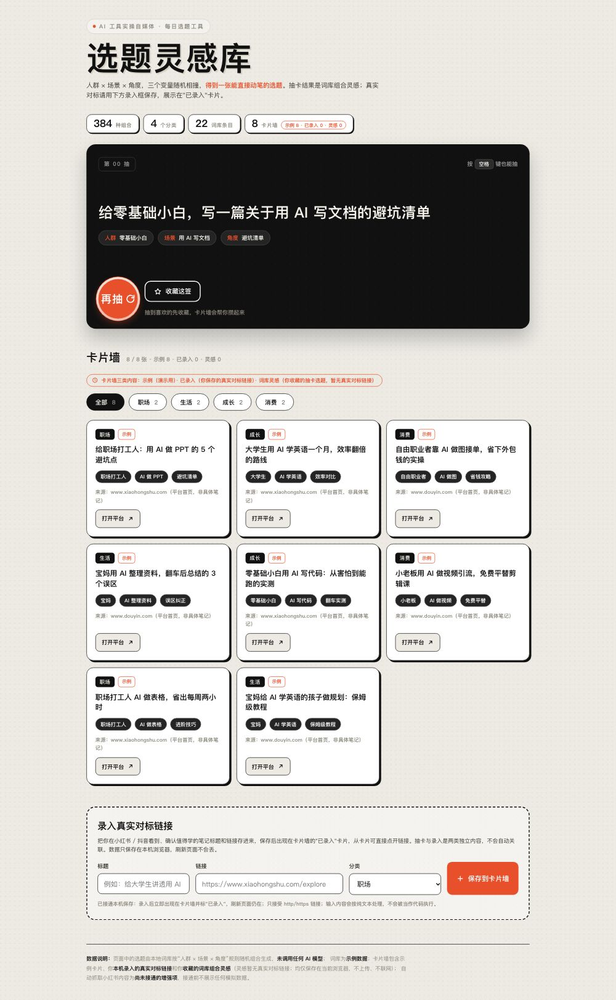

# 选题灵感库（topic-gacha）

为做「AI 工具实操」类内容的创作者准备的开源演示项目：把「人群 × 场景 × 角度」三个词库变量随机相撞成一张可直接动笔的选题卡，配抽卡、分类筛选、收藏与真实对标链接录入。界面为灰白纸感背景 + 粗黑标题 + 黑色抽卡区 + 橙红色圆形"再抽"按钮。

纯前端单文件，双击即可运行，也可部署到任意静态托管（如 GitHub Pages）。本项目用于求职/开源展示，也用于演示「AI 帮小白把想法做成可运行小项目」的完整过程。

## 界面预览

桌面端：



移动端：


## 核心功能

1. **抽卡生成选题**：从人群 / 场景 / 角度三个词库各取一项组合成完整选题（词库规则随机组合，**未调用任何 AI 模型**）；支持点击橙红圆形按钮或按空格键，组合计数实时显示。
2. **分类筛选 + 卡片墙**：按「职场 / 生活 / 成长 / 消费」分类筛选；卡片墙分三类内容：示例（演示用）、已录入（你保存的真实对标链接）、词库灵感（你收藏的抽卡选题，暂无真实对标链接）。
3. **收藏与录入**：抽到的选题可收藏/取消收藏（标记为"词库灵感"）；真实对标链接通过页面录入框添加（标记为"已录入"），只接受 http/https，内容按纯文本处理。两者均保存在**当前浏览器 localStorage**，刷新页面不丢。

## 运行方法

- **本地打开**：双击 `index.html`，无需安装、无需联网、无需登录。
- **在线访问**：GitHub Pages 演示地址见下方（部署自本仓库 `main` 分支）。
- **逻辑测试（纯 Node，不开浏览器）**：

```bash
node test-logic.cjs index.html
```

预期输出三行 `PASS`（覆盖：空/无效/重复录入拦截、存储重初始化、转义渲染、筛选计数含用户卡片、收藏/取消/无重复、无假源链接、筛选状态保留）。

## 数据说明

- 选题由本地词库按「人群 × 场景 × 角度」**规则组合**生成，非 AI 模型输出。
- 项目**不含任何真实笔记数据**，不接入爬虫；示例卡片明确标注"示例"，链接指向平台首页并注明"非具体笔记"。
- 录入的对标链接与收藏的灵感仅保存在当前浏览器 localStorage，不上传、不联网；清缓存或换浏览器会丢失。
- **自动抓取小红书内容尚未接通**（无公开官方 API，第三方方案存在登录/封号/许可限制，故未使用）。

## 参考与致谢

本项目为**独立原创实现，未复制任何第三方源码**。交互与生成思路参考了以下开源项目：

| 项目 | 许可证 | 参考点 |
| --- | --- | --- |
| [rbrutherford3/Tarot](https://github.com/rbrutherford3/Tarot) | MIT | 单页抽卡、数据文件驱动思路 |
| [AguzzTN54/Genshin-Impact-Wish-Simulator](https://github.com/AguzzTN54/Genshin-Impact-Wish-Simulator) | MIT | 抽卡交互模式思路 |
| [galaxykate/tracery](https://github.com/galaxykate/tracery) | Apache-2.0 | 词库组合生成思路（本项目为独立规则实现） |

调研阶段了解的爬虫类项目（如 MediaCrawler 等）仅作背景参考，因许可证与平台条款限制未使用。

## 实际测试与已知限制

**已执行**：纯 Node 逻辑断言（上述 `test-logic.cjs`）与静态渲染检查（无 console 错误、无资源错误、截图核对布局）。验收记录显示逻辑用例 16+17 项通过。

**未实测（如实标注，不宣称全面验收通过）**：真实浏览器点击交互、真实刷新后的持久化、外链访问。请按 README 运行方法自行验证。

**已知限制**：无后端与账号体系；数据仅本机；示例词库与示例卡片需自行替换为真实内容；自动抓取未接通。

## 许可证

[MIT](LICENSE) © 2026 alex999-ce
